<p align="center">
  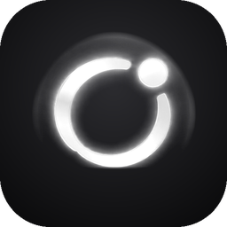
</p>

<h1 align="center">ZENO</h1>

<p align="center">
  <b>Talk to it. It gets things done.</b><br>
  A voice assistant with a team of AI workers.
</p>

<p align="center">
  
  
  
  
  
  
  
  
  
</p>

<p align="center">
  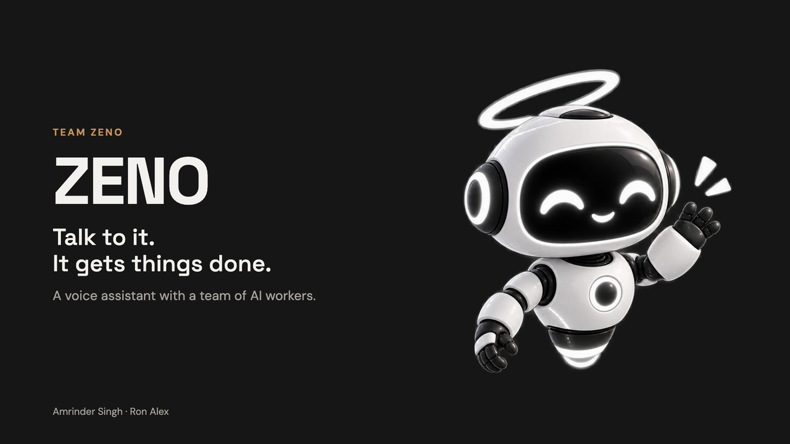
</p>

<p align="center">
  <a href="#what-it-can-do">Features</a> ·
  <a href="#how-it-works">How it works</a> ·
  <a href="#pitch-deck">Pitch deck</a> ·
  <a href="#tech-stack">Tech stack</a> ·
  <a href="#run-it-locally">Run it</a> ·
  <a href="#use-it-from-anywhere-cloudflare-tunnel">Deploy</a>
</p>

---

You talk to **ZENO**, by voice or text, from the Android app or the web dashboard. ZENO does quick
things itself. Anything bigger it hands to a **Bit** (BIT-01, BIT-02, BIT-03): an AI worker with its
own locked-down Docker sandbox where it can write and run code, read files, images and PDFs, use
your apps, browse the web, set reminders and keep watch for hours. ZENO keeps talking with you
meanwhile, passes the Bit's questions to you, and tells you the result.

<table align="center">
  <tr>
    <td align="center" width="50%"></td>
    <td align="center" width="50%"></td>
  </tr>
  <tr>
    <td align="center"><b>ZENO, the voice</b><br>You talk to it. It answers quick things and hands off the rest.</td>
    <td align="center"><b>Bits, the workers</b><br>AI workers with their own computer. They do the real work and report back.</td>
  </tr>
</table>

Built by **Team Zeno**: Amrinder Singh and Ron Alex.

## System overview

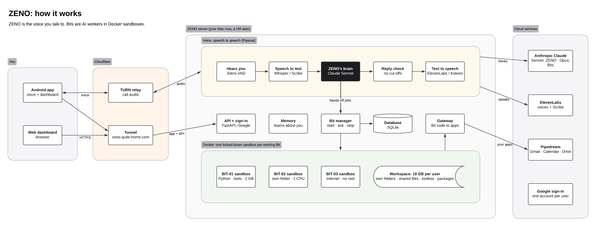

## How ZENO and the Bits work together

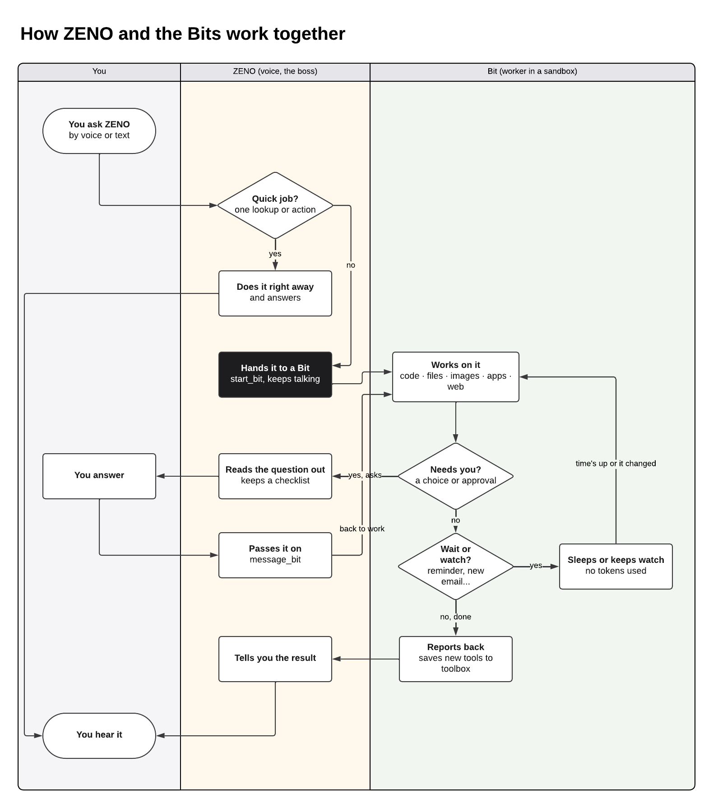

## What it can do

- **Talk naturally**: speech to speech over WebRTC, with interruptions, an animated avatar whose
  mouth follows the voice, and a choice of local or ElevenLabs voices.
- **Hand off real work**: "remind me in 10 minutes to…", "let me know when Sam emails",
  "download the attachment from my last email and summarize it", "research the best… and make me a
  table". ZENO starts a Bit and keeps the conversation going.
- **Run code**: Bits write and run Python and shell in their sandbox, `pip install` what they need,
  and run loops and long-running watchers.
- **See**: Bits look at images and read PDFs and documents.
- **Use your apps**: Gmail, Google Calendar, Drive and 2,000+ more through Pipedream, or any MCP
  server. ZENO and the Bits use the apps' tools, and code in a sandbox can call an app's own API
  signed in as you (for example, to download attachments).
- **Build tools**: when a Bit writes something reusable, it saves it to a toolbox that every later
  Bit can use.
- **Ask and answer**: a Bit can ask you a question and wait for the answer. ZENO reads it out, keeps
  a checklist of unanswered questions and brings them up again. You can message a working Bit or
  give a finished one a follow-up.
- **Remember you**: after each conversation ZENO updates what it knows about you; you can view and
  edit it on the dashboard.
- **Many users**: anyone can sign in with Google and gets their own private chats, memory, apps,
  Bits and storage.

### Example requests

- "What's on my calendar tomorrow?" (ZENO answers itself)
- "In 10 minutes, email Alex that I'm running late." (a Bit waits, then sends it)
- "Keep an eye on my inbox and tell me when the offer letter arrives." (a Bit keeps watch)
- "Open the PDF Sam sent me and give me the three key points." (a Bit downloads and reads it)
- "Compare the top five note-taking apps and put it in a spreadsheet." (a Bit researches and builds it)

## Dashboard

The web dashboard has the same voice chat as the app, plus pages for Bits (live work, questions,
files, the toolbox), Memory, Apps, Settings, and an **About** page that explains ZENO to new users.

<p align="center">
  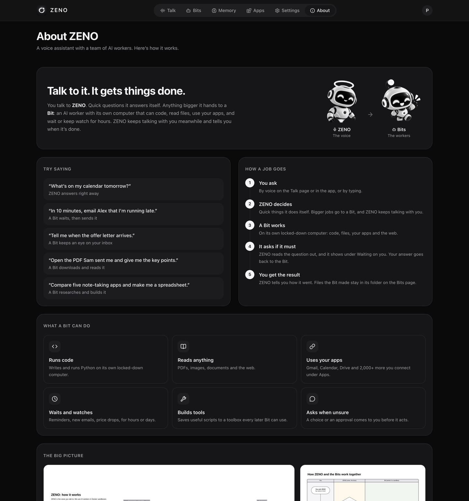
</p>

## Pitch deck

<table>
  <tr>
    <td></td>
    <td>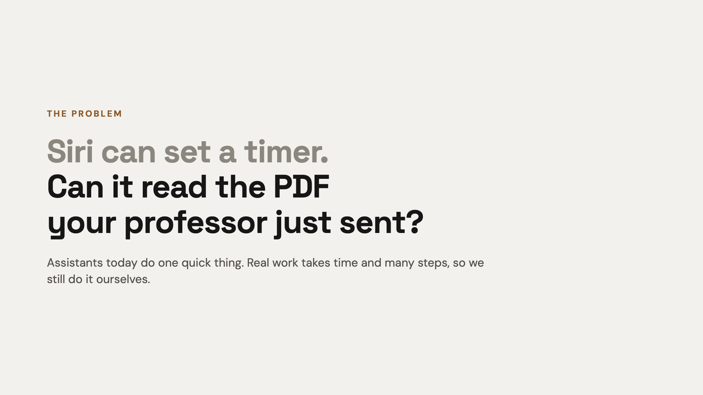</td>
  </tr>
  <tr>
    <td>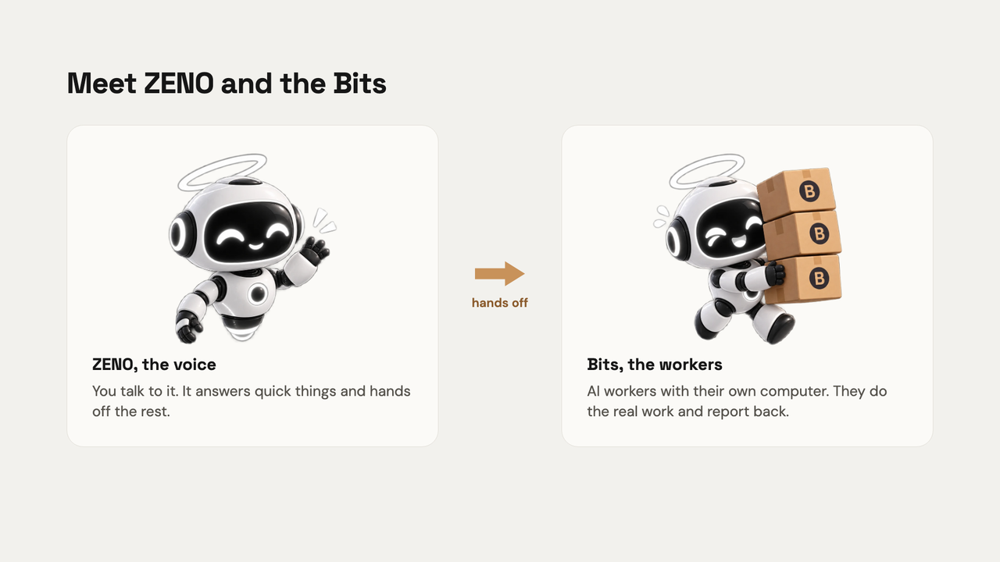</td>
    <td>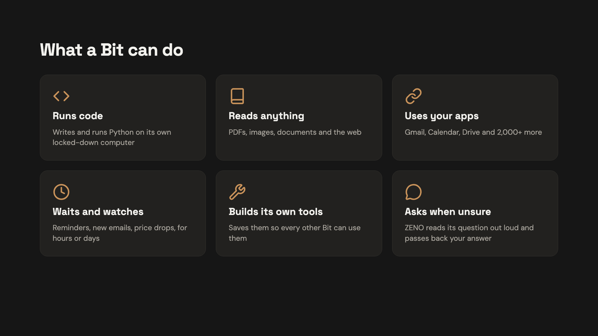</td>
  </tr>
  <tr>
    <td>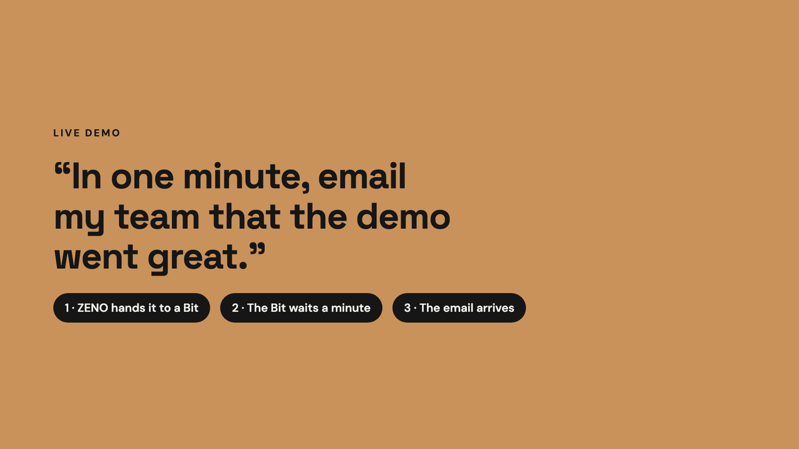</td>
    <td>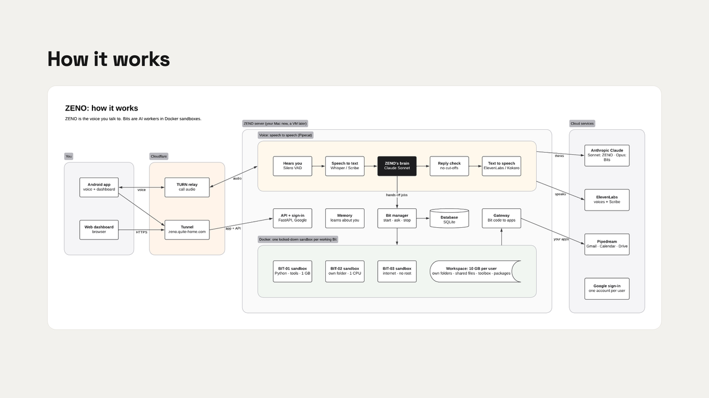</td>
  </tr>
  <tr>
    <td>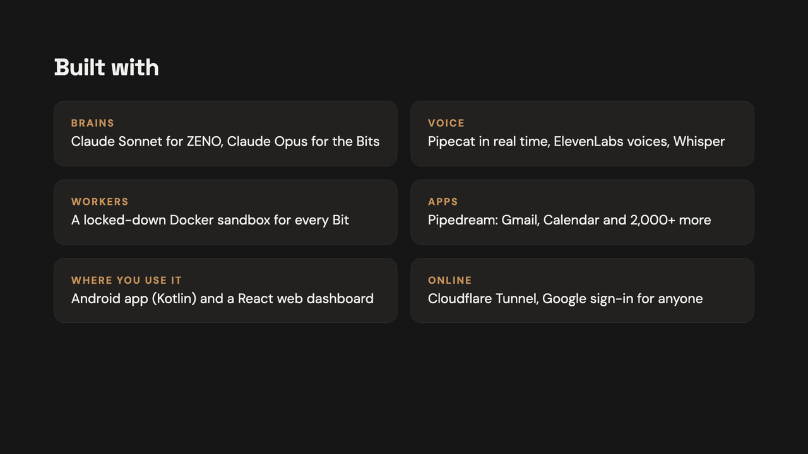</td>
    <td>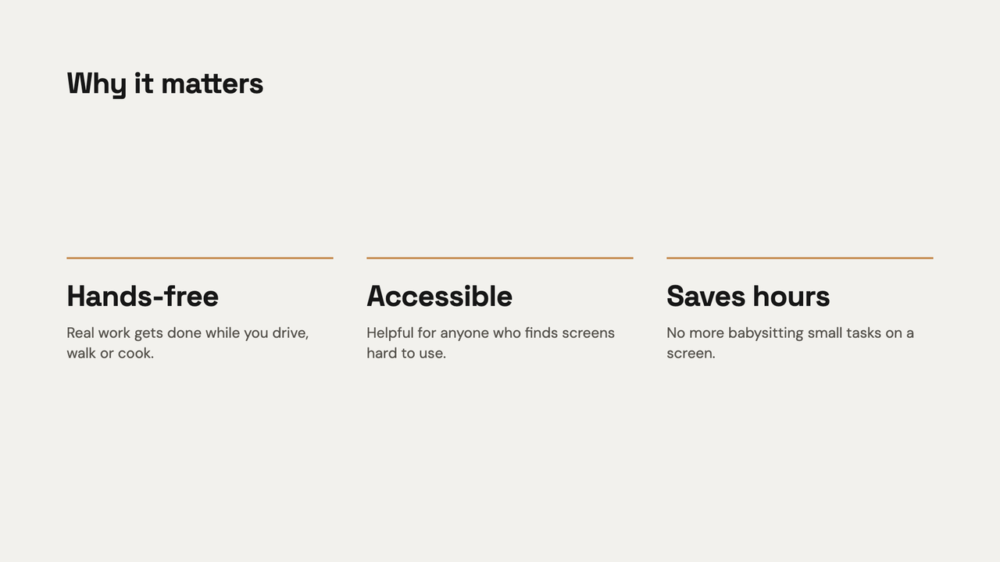</td>
  </tr>
  <tr>
    <td>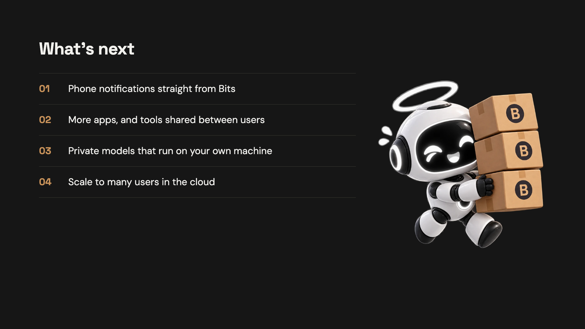</td>
    <td>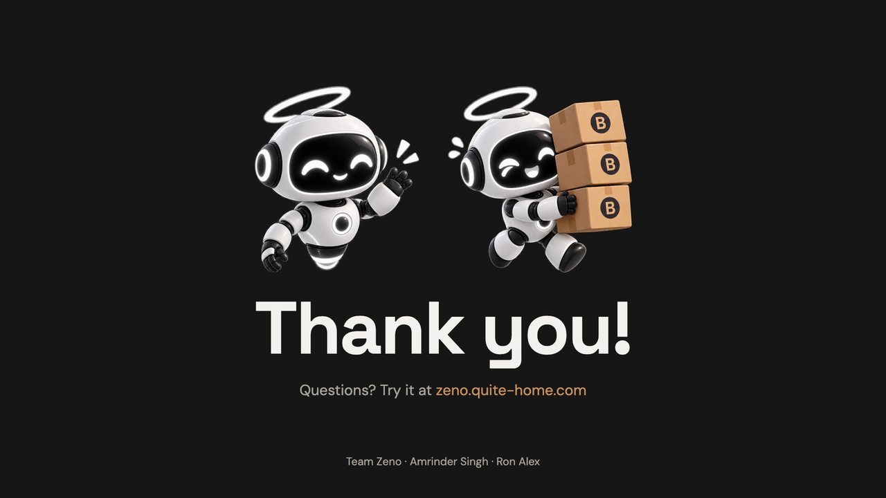</td>
  </tr>
</table>

## How it works

### ZENO, the voice (`bot.py`)

A [Pipecat](https://github.com/pipecat-ai/pipecat) pipeline, connected to the app or browser over
WebRTC:

| Step | What does it |
| --- | --- |
| Hears you | Silero VAD (voice activity detection) |
| Speech to text | MLX Whisper on Apple silicon, faster-whisper on Linux, or ElevenLabs Scribe |
| Thinks | The ZENO model (e.g. Claude Sonnet), with tools |
| Reply check | `reply_guard.py` keeps cut-off replies out of the voice and the chat history |
| Text to speech | Kokoro or Pocket TTS on the server, or ElevenLabs (Flash v2.5, Turbo, Multilingual) |

ZENO's tools (`tools.py`): `start_bit`, `message_bit`, `bit_status`, `stop_bit`, `remember`,
`forget`, `recall`, the time, plus the user's connected apps. App lookups run in the background so
the conversation never stalls. When a Bit asks something or sends an update, ZENO speaks it word
for word, so nothing gets lost in a retelling.

### Bits, the workers (`bits.py`, `bit_models.py`)

Each Bit is an LLM agent loop (e.g. Claude Opus) with these tools:

| Tool | What it does |
| --- | --- |
| `run_command` | bash or Python in the Bit's sandbox |
| `write_file`, `read_file`, `list_files`, `delete_file` | files in the Bit's own folder |
| `view_file` | look at an image or read a PDF |
| `share_file` | publish a file to `/workspace/shared` for other Bits and the user |
| `save_tool` | add a script to the toolbox (`/workspace/tools`) for every later Bit |
| `wait` | sleep until a time (reminders, "in 10 minutes"), using no tokens |
| `watch` | re-run a check every so often until its output changes (new email, price drop, …) |
| `ask_user` | ask the user something and wait for the answer |
| `notify_user` | tell the user something now |
| web search / fetch | Claude's own web tools for Claude models; DuckDuckGo from the sandbox otherwise |
| app tools | the user's connected apps (Gmail, Calendar, …) |

Long jobs stay cheap: while a Bit waits or watches it spends no tokens, and its step and token
limits reset after a rest. Bits that were waiting, watching or asking pick up again after a server
restart. Bits can chain: `start_bit(…, wait_for=["BIT-01"])` starts after BIT-01 and gets its report.

### Sandboxes and storage (`sandbox.py`)

Containers belong to jobs, not to users. Signing in starts nothing; a container exists only while a
Bit works on a task:

1. ZENO picks a free slot for that user (up to `MAX_BITS`, 3 by default).
2. It checks the sandbox image `zeno-sandbox:<hash>`, built once from
   `server/src/zeno_server/sandbox_image/Dockerfile` (Python 3.12 with requests, pandas, pypdf,
   pdfplumber, Pillow, tesseract, ffmpeg, poppler, git, …). Until it's built, Bits use
   `python:3.12-slim`.
3. It gives the Bit a random gateway token, valid only while the Bit works.
4. `docker run` starts `zeno-bit-<id>`, locked down: 1 CPU, 1 GB RAM, 256 processes, no Linux
   capabilities, no privilege escalation, read-only image, a 512 MB `/tmp`, running as the server's
   own user (not root).
5. Each command runs with `docker exec` and a time limit.
6. When the job ends or is stopped, the container is removed and the token revoked; the files stay.
   Leftover containers are cleaned up when the server starts.

Each user has one storage pool (`BIT_STORAGE_GB`, 10 GB by default) for all of their Bits:

```
server/data/workspaces/<user id>/
├── bit-01/   BIT-01's own folder, read-write in its container only
├── bit-02/
├── bit-03/
├── shared/   read-only in containers; Bits add files with share_file
├── tools/    the toolbox; read-only; Bits add tools with save_tool
└── .local/   Python packages the user's Bits installed with pip, shared by them
```

A Bit sees only its own folder plus `shared/`, `tools/` and `.local/`, never another Bit's folder
or another user's files. ZENO enforces the storage cap: writes over it are refused, and a command
that overfills the pool is stopped. `share_file` refuses to overwrite a file another Bit shared.

### The gateway (`gateway.py`, `sandbox_lib/`)

Code inside a sandbox reaches ZENO with the `zeno` command or `import zeno`, using its token:

| Endpoint | Use |
| --- | --- |
| `GET /api/bit-gateway/apps` | the user's app tools, and the apps whose API can be called |
| `POST /api/bit-gateway/tool` | call one of those tools |
| `POST /api/bit-gateway/api` | call an app's own API as the user (through the Pipedream Connect proxy) |
| `POST /api/bit-gateway/notify` | have ZENO tell the user something now |

ZENO looks up which Bit, and so which user, owns the token, so code can only ever reach that user's
apps.

### Memory (`memory.py`)

After each voice session the model summarizes the conversation and updates what ZENO knows about
the user: who they are, preferences, people, work. Users can also say "remember…" or "forget…", and
see, edit or turn off memory on the **Memory** page.

### Users and data (`auth.py`, `db.py`)

Users sign in with Google. One SQLite database (`server/data/zeno.db`) holds everyone's data, and
every row is tied to a user id, so each person sees only their own.

| Table | Holds |
| --- | --- |
| `users` | email, name, picture, chosen voice |
| `conversations` | past voice chats and their summaries |
| `memories` | what ZENO knows about each user |
| `mcp_servers` | each user's connected apps and custom MCP servers |
| `bits`, `bit_events` | each job, its status, result and token use, and its step-by-step log |
| `bit_messages` | Bit questions and updates, user answers and messages |
| `shared_files`, `bit_tools` | who shared which file; the toolbox |
| `app_settings` | server-wide settings: AI models, voice engine (API keys encrypted) |

App sign-ins (Gmail and so on) are kept by Pipedream under each user's id, not in ZENO's database.

### AI models (`llm.py`)

ZENO and the Bits each have their own model, chosen on the dashboard under
**Settings → AI models**: Anthropic Claude, Google Gemini, OpenAI, Lemonade or Ollama (local), or
any OpenAI-compatible server. A good pairing is a fast model for ZENO (Claude Sonnet) and a strong
one for the Bits (Claude Opus). API keys are stored encrypted with `SESSION_SECRET`.

## Tech stack

| Part | Built with |
| --- | --- |
| Server | Python 3.12, FastAPI, Uvicorn, [uv](https://docs.astral.sh/uv/) |
| Voice pipeline | Pipecat 1.12, SmallWebRTC, Silero VAD |
| Speech to text | MLX Whisper (Mac), faster-whisper (Linux), ElevenLabs Scribe |
| Text to speech | Kokoro, Pocket TTS, ElevenLabs |
| AI models | Anthropic SDK (Claude), OpenAI-compatible adapter (Gemini, OpenAI, Lemonade, Ollama) |
| Worker sandboxes | Docker (one hardened container per working Bit) |
| Database | SQLite |
| Files | pypdf, Pillow (images and PDFs for the models) |
| Web dashboard | React 19, TypeScript, Vite, Tailwind CSS 4, Pipecat client JS, lucide icons |
| Android app | Kotlin, Jetpack Compose (Material 3), Pipecat Android client + SmallWebRTC, Credential Manager (Google sign-in), kotlinx.serialization, Coil |
| Hosting | Cloudflare Tunnel (HTTPS), Cloudflare TURN (voice relay) |

## Services used

| Service | Used for | Needed? |
| --- | --- | --- |
| Anthropic Claude | ZENO's and the Bits' thinking; web search and fetch for Claude Bits | One AI model provider is needed (or a local model) |
| Google Cloud (OAuth) | Sign in with Google on the web and Android | Yes |
| Pipedream Connect | Users' apps (Gmail, Calendar, Drive, …) as tools, and the API proxy for code | For app features |
| ElevenLabs | Cloud voices and Scribe listening | Optional (local voices otherwise) |
| Cloudflare Tunnel | Reaching the server from anywhere over HTTPS | For use outside the home network |
| Cloudflare TURN | Relaying call audio when a direct connection isn't possible | For voice outside the home network |
| Docker | Bit sandboxes | For running code (Bits still work without it, minus commands) |
| Google Gemini, OpenAI, Lemonade, Ollama | Alternative AI models | Optional |

## Project layout

| Path | What it is |
| --- | --- |
| `server/` | FastAPI + Pipecat server: voice, Bits, sandboxes, memory, apps, API |
| `web/` | The dashboard; the server serves its build, so one port serves everything |
| `deploy/` | systemd unit and Cloudflare Tunnel config for a VM |
| `docs/images/`, `docs/slides/` | The diagrams, logo, screenshots and pitch slides above |
| `~/Desktop/android/ORION` | The Android app (separate project; package `com.example.zeno`, app id `com.example.orion`) |

Server modules (`server/src/zeno_server/`):

| Module | Job |
| --- | --- |
| `app.py` | FastAPI app: sign-in, WebRTC signaling, the dashboard API, serving the web build |
| `auth.py` | Google sign-in and sessions |
| `bot.py` | ZENO's voice pipeline and system prompt; Bit questions and updates in the conversation |
| `tools.py` | ZENO's tools |
| `bits.py` | Bit workers and the Bit manager |
| `bit_models.py` | One adapter per model API (Claude, OpenAI-compatible) behind one interface |
| `sandbox.py` | Workspaces, the storage pool, the sandbox image and containers |
| `sandbox_image/` | The sandbox's Dockerfile |
| `sandbox_lib/` | The `zeno` helper available inside every sandbox |
| `gateway.py` | The API code in a sandbox uses to reach ZENO and the user's apps |
| `connectors.py` | Pipedream Connect apps and custom MCP servers |
| `media.py` | Prepares images and PDFs for a model |
| `memory.py` | Long-term memory |
| `llm.py` | Model settings for ZENO and the Bits |
| `speech.py`, `voices.py`, `elevenlabs.py` | Speech to text, voices, ElevenLabs |
| `reply_guard.py` | Keeps cut-off replies out of the voice |
| `ice.py` | STUN/TURN servers for voice connections |
| `db.py`, `config.py` | SQLite storage; settings from `server/.env` |

## Run it locally

Needs Python 3.12+ with [uv](https://docs.astral.sh/uv/), Node 20+, and Docker (Docker Desktop on
a Mac).

```bash
cd server
cp .env.example .env        # fill in GOOGLE_CLIENT_IDS, SESSION_SECRET, Pipedream keys
uv sync
uv run zeno-server          # http://localhost:7860
```

```bash
cd web
npm install
npm run dev                 # http://localhost:5180 (proxies /api to :7860)
npm run build               # builds web/dist, which the server then serves on :7860
```

On first start ZENO builds its sandbox image (a few minutes; Bits use `python:3.12-slim`
meanwhile). Then sign in, and on the dashboard:

- **Settings → AI models**: pick ZENO's model and the Bits' model and add API keys;
- **Settings → Voice**: pick a voice, or add an ElevenLabs key;
- **Store**: connect apps like Gmail and Google Calendar.

The Android app: open `~/Desktop/android/ORION` in Android Studio, run it, and set the server
address on the sign-in screen.

## Configuration

Main settings in `server/.env` (all are listed in `server/.env.example`):

| Setting | What it does |
| --- | --- |
| `SESSION_SECRET` | Signs sessions and encrypts stored API keys |
| `GOOGLE_CLIENT_IDS` | Google OAuth client IDs (web and Android) |
| `ALLOWED_EMAILS` | Who may sign in; empty means anyone with a Google account |
| `ADMIN_EMAILS` | Who may change server-wide settings (models, voice engine) |
| `PIPEDREAM_CLIENT_ID`, `PIPEDREAM_CLIENT_SECRET`, `PIPEDREAM_PROJECT_ID`, `PIPEDREAM_ENVIRONMENT` | Pipedream Connect |
| `LLM_BASE_URL`, `LLM_MODEL`, `LLM_API_KEY` | A default model (models can also be set on the dashboard) |
| `MAX_BITS` | Bits each user can run at once (3) |
| `BIT_STORAGE_GB` | Each user's storage pool (10) |
| `BIT_MAX_STEPS`, `BIT_MAX_TOKENS`, `BIT_COMMAND_TIMEOUT` | Limits per Bit |
| `SANDBOX_IMAGE`, `SANDBOX_CPUS`, `SANDBOX_MEMORY`, `SANDBOX_NETWORK` | Sandbox image (`auto`) and limits |
| `STT_ENGINE`, `WHISPER_MODEL`, `KOKORO_VOICE` | Local speech settings |
| `CORS_ORIGINS` | Web addresses allowed to call the API |
| `CLOUDFLARE_TURN_KEY_ID`, `CLOUDFLARE_TURN_API_TOKEN` | Voice relay for calls from outside the network |
| `DATA_DIR` | Where the database and workspaces live |

## Use it from anywhere: Cloudflare Tunnel

The server listens on `localhost:7860`. A Cloudflare Tunnel gives it a public HTTPS address without
opening any ports: `cloudflared` on the server connects out to Cloudflare, and Cloudflare sends
visitors back through that connection.

```
Phone / browser ──https──► Cloudflare ◄──outbound tunnel── cloudflared ──► http://localhost:7860
```

1. Put your domain on Cloudflare and install `cloudflared`.
2. Create the tunnel and its DNS record:
   ```bash
   cloudflared tunnel login
   cloudflared tunnel create zeno
   cloudflared tunnel route dns zeno zeno.example.com
   ```
3. Write a config (see `deploy/cloudflared.yml`) that sends `zeno.example.com` to
   `http://localhost:7860`. On networks that block QUIC (some campus Wi-Fi), add
   `protocol: http2`.
4. Run it: `cloudflared tunnel --config <config> run`, or install it as a service so it starts
   with the machine.
5. Add `https://zeno.example.com` to `CORS_ORIGINS`, and in Google Cloud to the web OAuth client's
   **Authorized JavaScript origins**. Publish the OAuth consent screen so anyone can sign in.
6. **Voice**: the tunnel carries web traffic, not WebRTC's UDP audio. In the Cloudflare dashboard,
   create a TURN key (Realtime → TURN) and set `CLOUDFLARE_TURN_KEY_ID` and
   `CLOUDFLARE_TURN_API_TOKEN`; ZENO hands each call short-lived relay credentials. (Or run coturn
   and set `TURN_URLS`, `TURN_USERNAME`, `TURN_CREDENTIAL`.)
7. In the Android app, set the server to `https://zeno.example.com`.

### On a Linux VM

1. Ubuntu/Debian with a persistent disk. Install `uv`, Node 20+, Docker and `cloudflared`. Create
   a `zeno` user and add it to the `docker` group.
2. Clone to `/opt/zeno`, then `cd server && uv sync` and `cd ../web && npm ci && npm run build`.
   Speech to text uses faster-whisper automatically (`STT_ENGINE=auto`).
3. `cp server/.env.example server/.env` and fill it in as above. Also set
   `BIT_GATEWAY_URL=https://zeno.example.com` (already in `deploy/zeno.service`): on Linux, code in
   the sandboxes reaches ZENO's gateway through the tunnel, since ZENO listens on localhost.
4. `sudo cp deploy/zeno.service /etc/systemd/system/ && sudo systemctl enable --now zeno` (data
   goes to `DATA_DIR=/var/lib/zeno`).
5. Set up the tunnel and TURN as above.

## Security notes

- Each user's data is separated by user id in the database and by folder on disk; a Bit's container
  only mounts its own user's folders.
- Sandboxes are hardened (no capabilities, no privilege escalation, read-only image, CPU, memory
  and process limits) but have network access (`SANDBOX_NETWORK=bridge`) so Bits can browse and
  install packages. Set `SANDBOX_NETWORK=none` to cut it off.
- Gateway tokens are random, per Bit, kept in memory and revoked when the Bit ends.
- API keys saved on the dashboard are encrypted with `SESSION_SECRET`; `server/.env` is never
  committed.
- `MAX_BITS` is per user; with many users, the total number of containers is `MAX_BITS` × active
  users, so size the machine (or lower the limit) accordingly.

## Growing with users

- **More sign-in options**: `auth.py` turns a provider's identity into a ZENO user and session; add
  providers next to Google without touching the rest.
- **Database**: SQLite is fine for one server. For several, move `db.py` to Postgres; all access goes
  through that module.
- **Sandboxes**: `sandbox.py` talks to Docker through one class; swap in Kubernetes Jobs or a hosted
  sandbox for more isolation or scale. For a hard per-user disk cap, give each user's pool its own
  volume with a filesystem quota.
- **Limits**: `MAX_BITS`, `BIT_STORAGE_GB` and `BIT_MAX_TOKENS` are per user; per-plan limits would
  live next to them.
